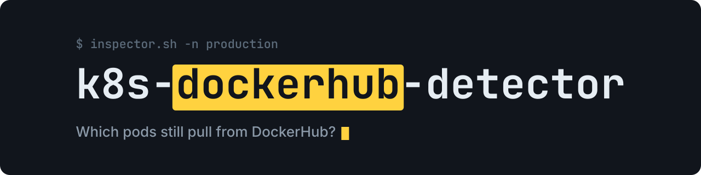

<p align="center">
  
</p>

<h1 align="center">k8s-dockerhub-detector</h1>

<p align="center">Lists every pod in a Kubernetes cluster that still pulls images from Docker Hub, so you can move them before the pull rate limit bites.</p>

<p align="center">
  <a href="LICENSE"></a>
</p>

---

A bash script over `kubectl`: it reads the images of the containers and init containers of every pod, treats an image with no registry host (or with `docker.io`) as Docker Hub, prints the matching pods grouped by namespace, and ends with totals of all and of distinct Docker Hub images.

## Quick start

```bash
curl -O https://raw.githubusercontent.com/GeiserX/k8s-dockerhub-detector/main/inspector.sh
bash inspector.sh              # every namespace; add -n <namespace> for one
```

Needs `kubectl` pointed at the cluster and bash 4 or newer (the script uses associative arrays; macOS ships bash 3.2, so use Homebrew's bash there).

## Origin

Written and run in early 2025, when Docker announced that unauthenticated pulls would drop to 10 per hour per IPv4 address (from the 100 per 6 hours set in November 2020) starting 1 April 2025. Clusters that pulled everything from Docker Hub had weeks to find and move those images, and this script was the inventory. Docker later held the old limits, but the need to know what still pulls from Docker Hub did not go away. The script was published here on 26 April 2025, after it had done that job.

## License

[GPL-3.0-or-later](LICENSE)
